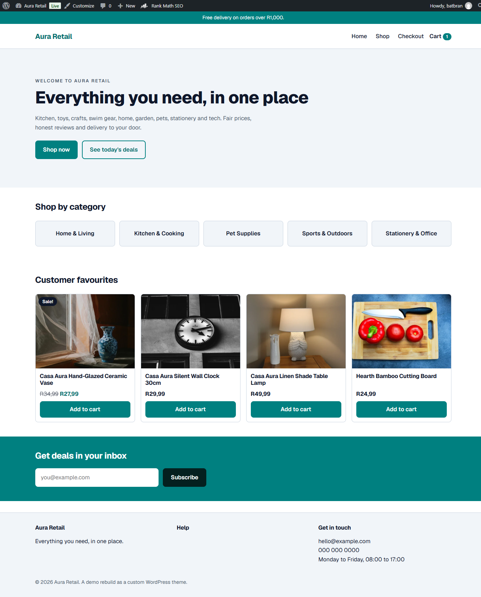
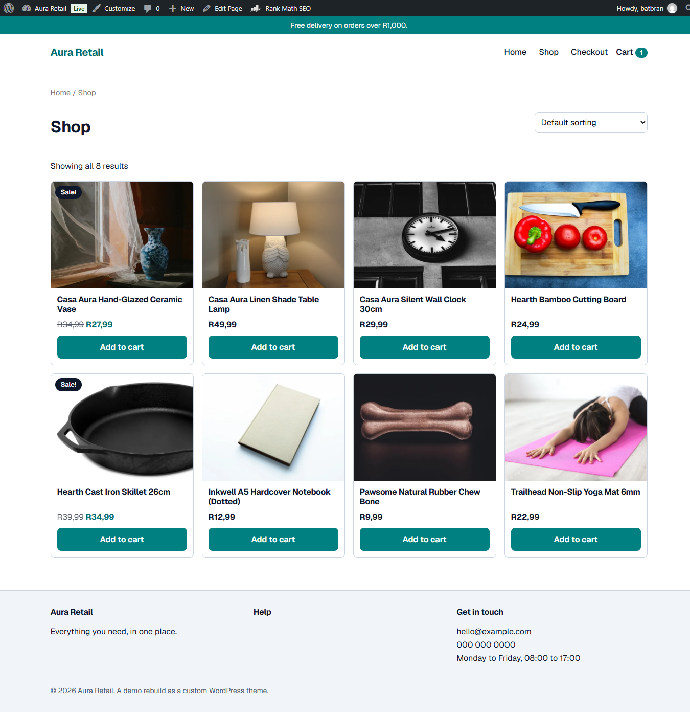
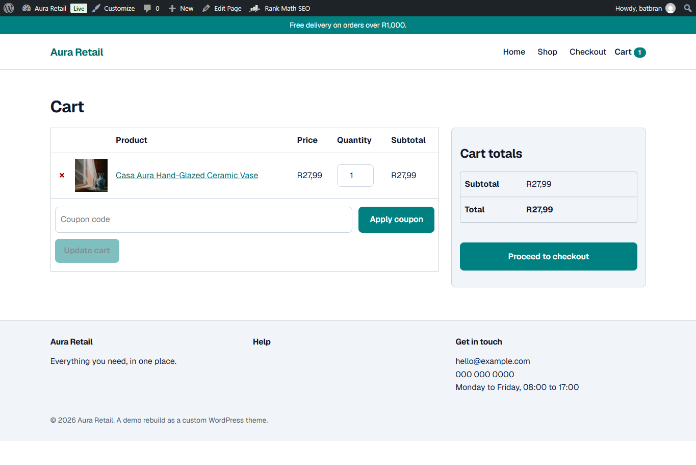
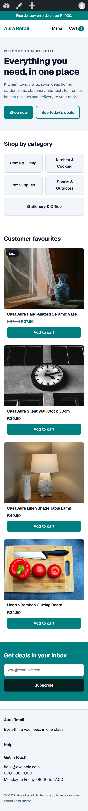

# Aura Retail: WordPress + WooCommerce

A recent rebuild of my Aura Retail store as a custom classic WordPress theme with WooCommerce. The original Aura Retail was a custom full-stack JavaScript app; this version re-creates its storefront in PHP and the WordPress template system, and is a separate project.

## Features

- **Custom classic theme:** hand-written PHP templates (`front-page.php`, `page.php`, `index.php`, `404.php`, `header.php`, `footer.php`) and reusable `template-parts/`. No page builder, starter framework, Tailwind or build tools.
- **Home page:** hero, category tiles, featured products and a newsletter block (nonce-protected form handler).
- **WooCommerce template overrides:** shop archive, product card, single product, cart and checkout, copied from WooCommerce 11.2.2 and styled to the brand.
- **Hooks and filters:** cart count in the header refreshed through WooCommerce cart fragments, theme supports, custom image sizes, and menu and stylesheet filters.
- **Performance:** Geist variable font self-hosted in the theme with `font-display: swap` (no third-party font request), plus custom 4:3 image sizes (`add_image_size`) so product images are served at the right dimensions.
- **Responsive layout:** mobile-first CSS, checked at 360px, 768px and 1280px, with 44px minimum touch targets on buttons.
- **Accessibility basics:** skip link, semantic landmarks, visible `:focus-visible` styles, escaped output.
- **SEO:** set up with the Rank Math plugin: page titles, meta descriptions, Open Graph tags, an XML sitemap, and WooCommerce Product schema as JSON-LD (generated by Rank Math, not hand-written).

## Tech

WordPress, PHP, WooCommerce, HTML, CSS and vanilla JavaScript.

## Install

1. Copy `themes/aura-retail/` into your site's `wp-content/themes/` folder and activate it under **Appearance > Themes**.
2. Install and activate **WooCommerce** (**Plugins > Add New**).
3. Import `sample-data/products.csv` via **Products > Import**. The CSV has no images; add product photos in the Media Library and attach them.
4. Go to **Settings > Permalinks** and choose **Post name**.
5. Edit the **Cart** and **Checkout** pages so their content is the `[woocommerce_cart]` and `[woocommerce_checkout]` shortcodes (the overrides target the classic, non-block templates).
6. Assign a menu to the **Primary** location under **Appearance > Menus**, and set a static front page under **Settings > Reading**.

## Screenshots

### Home

### Shop

### Cart

### Mobile (360px)

## Lighthouse

Lighthouse (mobile, home page, local development site over HTTP): Performance 97, Accessibility 100, Best Practices 78 (the two failing checks are the HTTPS ones, which don't apply on a local site), SEO 100.

## What I learned

This was my first time building in WordPress. Coming from WeWeb and Xano, it felt like the same idea with much more control: a CMS plus a real backend, where I can change how everything works through themes, hooks and plugins. The e-commerce flow was familiar from building Aura Retail, so the new part was learning how WordPress and WooCommerce do it: template overrides, filters and fragments. I picked up the basics of hooks and plugins quickly, and I know there is a lot more depth to learn, which I’d want to keep learning on the job.
